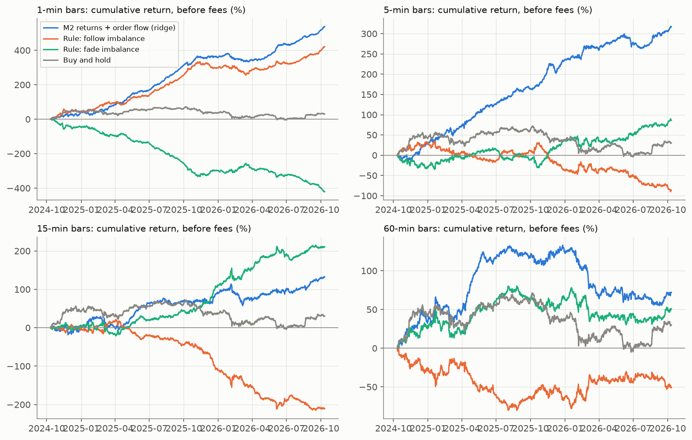
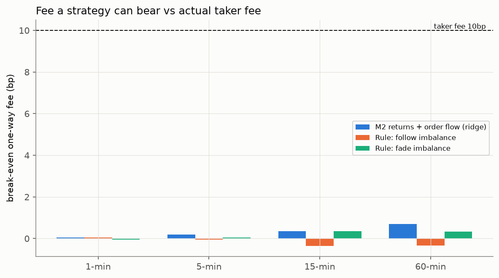

# 체결(aggTrades) 기반 주문흐름 백테스트 — 전체 기간

- 데이터: Binance 현물 BTCUSDT aggTrades 1096일, 2023-10-11 ~ 2026-10-10 UTC, 체결 1,365,393,853건
- 빈 분(체결 없음): 0분 (0.000%) — 점검 등, 해당 봉은 결측 처리
- 가격: 27,389 → 82,988 USDT
- 검증 구간(표본 외): 2024-10-11 ~ 2026-10-10 (첫 12개월은 학습 전용, 이후 분기마다 재학습하는 워크포워드)
- 비용: 편도 0, 1, 10bp 시나리오 (10bp = Binance 현물 기본 테이커)
- 재현: `python impact/analyze_aggtrades_backtest.py` / 공식·분석 계획: `impact/trade_flow_backtest.py`
- 분석 계획은 결과를 보기 전에 고정했다 (봉 크기·모형·비용·검정 모두 코드 상단 상수). 결과를 보고 바꾸지 않았다.

## 핵심 결과 (표에서 자동 생성)

- **크기 예측**: Clark–West 유의(p<0.05) — 1분 M2 수익률+주문흐름 릿지(R² 0.008%), 5분 M1 과거수익률 릿지(R² 0.003%), 5분 M2 수익률+주문흐름 릿지(R² 0.004%), 15분 M2 수익률+주문흐름 릿지(R² 0.009%). (R²가 0 근처이거나 음수인데 유의한 것은 Clark–West의 성질이며, 실질적 크기는 R²로 판단)
- **비용 전 최고 샤프**: 1분 M2 수익률+주문흐름 릿지 (샤프 5.87, 손익분기 수수료 0.05bp).
- **편도 1bp 수수료 후**: 샤프가 양수인 전략이 하나도 없다.
- **편도 10bp 수수료 후**: 샤프가 양수인 전략이 하나도 없다.
- **플라시보 유의(비용 전)**: 1분 M2 수익률+주문흐름 릿지(p=0.000), 1분 규칙: 불균형 추종(p=0.000), 5분 M2 수익률+주문흐름 릿지(p=0.000), 15분 M2 수익률+주문흐름 릿지(p=0.024), 15분 규칙: 불균형 역추세(p=0.001).

## 1. 예측력 (표본 외)

표본 외 R²는 '수익률 0' 예측 대비 오차 감소율. Clark–West = 크기 예측력, PT = Pesaran–Timmermann 방향 예측력(적중률이 독립일 때 기대치보다 높은가).
표본 수가 수십만~백만 개라 아주 작은 효과도 유의해질 수 있으므로 **크기(R²·적중률)와 아래 비용 후 성과를 함께** 본다.

|    |   bar_min |          model |    n_bars |   oos_r2_pct |   clark_west_t |   clark_west_p |   hit_rate |   hit_rate_if_independent |      pt_p |
|---:|----------:|---------------:|----------:|-------------:|---------------:|---------------:|-----------:|--------------------------:|----------:|
|  0 |         1 |    M1 과거수익률 릿지 | 1,050,479 |   -0.0008838 |          1.445 |        0.07423 |     0.4928 |                    0.4939 |    0.9929 |
|  1 |         1 | M2 수익률+주문흐름 릿지 | 1,050,479 |     0.008393 |          10.85 |              0 |     0.5077 |                    0.4987 |         0 |
|  2 |         5 |    M1 과거수익률 릿지 |   210,095 |     0.003492 |          2.233 |        0.01276 |     0.5065 |                    0.4993 | 1.175e-12 |
|  3 |         5 | M2 수익률+주문흐름 릿지 |   210,095 |     0.004379 |          3.295 |      0.0004924 |     0.5098 |                    0.4997 |         0 |
|  4 |        15 |    M1 과거수익률 릿지 |    70,031 |    -0.004007 |         0.8239 |          0.205 |     0.5062 |                    0.4991 | 1.413e-07 |
|  5 |        15 | M2 수익률+주문흐름 릿지 |    70,031 |     0.008723 |          3.426 |      0.0003061 |     0.5144 |                    0.4996 |  1.11e-16 |
|  6 |        60 |    M1 과거수익률 릿지 |    17,507 |     -0.02307 |         0.9742 |          0.165 |     0.5129 |                     0.503 | 0.0002681 |
|  7 |        60 | M2 수익률+주문흐름 릿지 |    17,507 |     -0.05532 |          1.492 |        0.06785 |     0.5152 |                    0.5018 | 5.714e-05 |

## 2. 전략 성과 (비용 시나리오별)

`mean_bp_per_bar` 봉당 평균 손익(bp), `sharpe` 연율화 샤프, `total_return_pct` 단리 누적 수익률, `trades_per_day` 하루 거래량(포지션 변화량), `breakeven_cost_bp` 이 전략이 비용 0에서 번 돈을 편도 수수료로 나눈 값 — **실제 수수료가 이보다 낮아야 이익**.

|    |   bar_min |       strategy |   cost_bp |   mean_bp_per_bar |   sharpe |   total_return_pct |   max_drawdown_pct |   trades_per_day |   breakeven_cost_bp |
|---:|----------:|---------------:|----------:|------------------:|---------:|-------------------:|-------------------:|-----------------:|--------------------:|
|  0 |         1 |    M1 과거수익률 릿지 |         0 |           0.04047 |    4.635 |              425.1 |             -58.56 |            1,048 |             0.05561 |
|  1 |         1 |    M1 과거수익률 릿지 |         1 |           -0.6872 |   -77.81 |             -7,219 |             -7,219 |            1,048 |             0.05561 |
|  2 |         1 |    M1 과거수익률 릿지 |        10 |            -7.236 |   -455.4 |            -76,012 |            -76,012 |            1,048 |             0.05561 |
|  3 |         1 | M2 수익률+주문흐름 릿지 |         0 |           0.05124 |    5.869 |              538.3 |             -50.48 |            1,387 |             0.05321 |
|  4 |         1 | M2 수익률+주문흐름 릿지 |         1 |           -0.9119 |   -103.2 |             -9,579 |             -9,579 |            1,387 |             0.05321 |
|  5 |         1 | M2 수익률+주문흐름 릿지 |        10 |             -9.58 |   -587.4 |           -100,633 |           -100,633 |            1,387 |             0.05321 |
|  6 |         1 |     규칙: 불균형 추종 |         0 |           0.04007 |    4.589 |              420.9 |             -77.34 |            1,287 |             0.04483 |
|  7 |         1 |     규칙: 불균형 추종 |         1 |           -0.8536 |   -96.65 |             -8,967 |             -8,967 |            1,287 |             0.04483 |
|  8 |         1 |     규칙: 불균형 추종 |        10 |            -8.897 |   -548.3 |            -93,461 |            -93,461 |            1,287 |             0.04483 |
|  9 |         1 |    규칙: 불균형 역추세 |         0 |          -0.04007 |   -4.589 |             -420.9 |             -423.4 |            1,287 |            -0.04483 |
| 10 |         1 |    규칙: 불균형 역추세 |         1 |           -0.9338 |   -105.6 |             -9,809 |             -9,809 |            1,287 |            -0.04483 |
| 11 |         1 |    규칙: 불균형 역추세 |        10 |            -8.977 |   -551.1 |            -94,302 |            -94,302 |            1,287 |            -0.04483 |
| 12 |         1 |          단순 보유 |         0 |          0.002903 |   0.3324 |              30.49 |             -77.88 |         0.001371 |                     |
| 13 |         1 |          단순 보유 |         1 |          0.002902 |   0.3323 |              30.48 |             -77.88 |         0.001371 |                     |
| 14 |         1 |          단순 보유 |        10 |          0.002893 |   0.3314 |              30.39 |             -77.88 |         0.001371 |                     |
| 15 |         5 |    M1 과거수익률 릿지 |         0 |            0.1232 |    2.824 |              258.9 |             -32.66 |              260 |              0.1365 |
| 16 |         5 |    M1 과거수익률 릿지 |         1 |           -0.7797 |   -17.82 |             -1,638 |             -1,639 |              260 |              0.1365 |
| 17 |         5 |    M1 과거수익률 릿지 |        10 |            -8.906 |   -166.9 |            -18,711 |            -18,711 |              260 |              0.1365 |
| 18 |         5 | M2 수익률+주문흐름 릿지 |         0 |            0.1512 |    3.464 |              317.6 |             -38.07 |            217.6 |              0.2001 |
| 19 |         5 | M2 수익률+주문흐름 릿지 |         1 |           -0.6044 |   -13.82 |             -1,270 |             -1,271 |            217.6 |              0.2001 |
| 20 |         5 | M2 수익률+주문흐름 릿지 |        10 |            -7.405 |   -139.9 |            -15,557 |            -15,557 |            217.6 |              0.2001 |
| 21 |         5 |     규칙: 불균형 추종 |         0 |           -0.0414 |  -0.9487 |             -86.98 |             -126.3 |            249.7 |            -0.04776 |
| 22 |         5 |     규칙: 불균형 추종 |         1 |           -0.9083 |   -20.78 |             -1,908 |             -1,911 |            249.7 |            -0.04776 |
| 23 |         5 |     규칙: 불균형 추종 |        10 |             -8.71 |   -164.2 |            -18,300 |            -18,300 |            249.7 |            -0.04776 |
| 24 |         5 |    규칙: 불균형 역추세 |         0 |            0.0414 |   0.9487 |              86.98 |             -50.58 |            249.7 |             0.04776 |
| 25 |         5 |    규칙: 불균형 역추세 |         1 |           -0.8255 |   -18.86 |             -1,734 |             -1,735 |            249.7 |             0.04776 |
| 26 |         5 |    규칙: 불균형 역추세 |        10 |            -8.627 |   -161.2 |            -18,126 |            -18,126 |            249.7 |             0.04776 |
| 27 |         5 |          단순 보유 |         0 |           0.01451 |   0.3326 |              30.49 |              -77.3 |         0.001371 |                     |
| 28 |         5 |          단순 보유 |         1 |           0.01451 |   0.3324 |              30.48 |              -77.3 |         0.001371 |                     |
| 29 |         5 |          단순 보유 |        10 |           0.01446 |   0.3315 |              30.39 |              -77.3 |         0.001371 |                     |
| 30 |        15 |    M1 과거수익률 릿지 |         0 |          0.009588 |  0.07433 |              6.714 |             -69.13 |             31.5 |             0.02922 |
| 31 |        15 |    M1 과거수익률 릿지 |         1 |           -0.3185 |   -2.468 |             -223.1 |               -234 |             31.5 |             0.02922 |
| 32 |        15 |    M1 과거수익률 릿지 |        10 |            -3.271 |   -24.22 |             -2,291 |             -2,292 |             31.5 |             0.02922 |
| 33 |        15 | M2 수익률+주문흐름 릿지 |         0 |            0.1895 |    1.469 |              132.7 |             -57.53 |            50.06 |              0.3634 |
| 34 |        15 | M2 수익률+주문흐름 릿지 |         1 |            -0.332 |   -2.572 |             -232.5 |               -240 |            50.06 |              0.3634 |
| 35 |        15 | M2 수익률+주문흐름 릿지 |        10 |            -5.025 |   -36.59 |             -3,519 |             -3,520 |            50.06 |              0.3634 |
| 36 |        15 |     규칙: 불균형 추종 |         0 |           -0.3011 |   -2.334 |             -210.8 |               -237 |            81.99 |             -0.3525 |
| 37 |        15 |     규칙: 불균형 추종 |         1 |            -1.155 |   -8.951 |             -808.9 |             -811.2 |            81.99 |             -0.3525 |
| 38 |        15 |     규칙: 불균형 추종 |        10 |            -8.842 |   -63.63 |             -6,192 |             -6,192 |            81.99 |             -0.3525 |
| 39 |        15 |    규칙: 불균형 역추세 |         0 |            0.3011 |    2.334 |              210.8 |             -38.24 |            81.99 |              0.3525 |
| 40 |        15 |    규칙: 불균형 역추세 |         1 |            -0.553 |   -4.282 |             -387.3 |             -389.9 |            81.99 |              0.3525 |
| 41 |        15 |    규칙: 불균형 역추세 |        10 |             -8.24 |   -58.92 |             -5,770 |             -5,770 |            81.99 |              0.3525 |
| 42 |        15 |          단순 보유 |         0 |           0.04346 |   0.3369 |              30.44 |              -77.3 |         0.001371 |                     |
| 43 |        15 |          단순 보유 |         1 |           0.04345 |   0.3368 |              30.43 |              -77.3 |         0.001371 |                     |
| 44 |        15 |          단순 보유 |        10 |           0.04332 |   0.3358 |              30.34 |              -77.3 |         0.001371 |                     |
| 45 |        60 |    M1 과거수익률 릿지 |         0 |            0.3914 |   0.7674 |              68.51 |             -53.93 |            12.68 |              0.7408 |
| 46 |        60 |    M1 과거수익률 릿지 |         1 |           -0.1369 |  -0.2685 |             -23.98 |             -102.3 |            12.68 |              0.7408 |
| 47 |        60 |    M1 과거수익률 릿지 |        10 |            -4.892 |    -9.43 |             -856.4 |             -870.1 |            12.68 |              0.7408 |
| 48 |        60 | M2 수익률+주문흐름 릿지 |         0 |            0.4115 |   0.8068 |              72.04 |             -79.59 |            13.97 |              0.7069 |
| 49 |        60 | M2 수익률+주문흐름 릿지 |         1 |           -0.1706 |  -0.3345 |             -29.87 |             -137.4 |            13.97 |              0.7069 |
| 50 |        60 | M2 수익률+주문흐름 릿지 |        10 |             -5.41 |   -10.42 |             -947.1 |             -947.4 |            13.97 |              0.7069 |
| 51 |        60 |     규칙: 불균형 추종 |         0 |           -0.2913 |  -0.5711 |             -50.99 |             -81.38 |            20.63 |             -0.3389 |
| 52 |        60 |     규칙: 불균형 추종 |         1 |            -1.151 |   -2.256 |             -201.5 |             -201.1 |            20.63 |             -0.3389 |
| 53 |        60 |     규칙: 불균형 추종 |        10 |            -8.886 |   -17.08 |             -1,556 |             -1,555 |            20.63 |             -0.3389 |
| 54 |        60 |    규칙: 불균형 역추세 |         0 |            0.2913 |   0.5711 |              50.99 |             -51.07 |            20.63 |              0.3389 |
| 55 |        60 |    규칙: 불균형 역추세 |         1 |           -0.5682 |   -1.114 |             -99.48 |             -138.5 |            20.63 |              0.3389 |
| 56 |        60 |    규칙: 불균형 역추세 |        10 |            -8.304 |   -15.92 |             -1,454 |             -1,455 |            20.63 |              0.3389 |
| 57 |        60 |          단순 보유 |         0 |            0.1723 |   0.3378 |              30.16 |             -77.09 |         0.001371 |                     |
| 58 |        60 |          단순 보유 |         1 |            0.1722 |   0.3377 |              30.15 |             -77.09 |         0.001371 |                     |
| 59 |        60 |          단순 보유 |        10 |            0.1717 |   0.3367 |              30.06 |             -77.09 |         0.001371 |                     |

## 3. 플라시보 (비용 전)

포지션 순서를 무작위로 섞어 2,000번 반복한 샤프 분포 대비 실제 샤프의 단측 p값.

|    |   bar_min |       strategy |   gross_sharpe |   placebo_p |
|---:|----------:|---------------:|---------------:|------------:|
|  0 |         1 | M2 수익률+주문흐름 릿지 |          5.869 |   0.0004998 |
|  1 |         1 |     규칙: 불균형 추종 |          4.589 |   0.0004998 |
|  2 |         1 |    규칙: 불균형 역추세 |         -4.589 |           1 |
|  3 |         5 | M2 수익률+주문흐름 릿지 |          3.464 |   0.0004998 |
|  4 |         5 |     규칙: 불균형 추종 |        -0.9487 |      0.9025 |
|  5 |         5 |    규칙: 불균형 역추세 |         0.9487 |     0.09795 |
|  6 |        15 | M2 수익률+주문흐름 릿지 |          1.469 |     0.02399 |
|  7 |        15 |     규칙: 불균형 추종 |         -2.334 |      0.9995 |
|  8 |        15 |    규칙: 불균형 역추세 |          2.334 |   0.0009995 |
|  9 |        60 | M2 수익률+주문흐름 릿지 |         0.8068 |      0.1484 |
| 10 |        60 |     규칙: 불균형 추종 |        -0.5711 |      0.7726 |
| 11 |        60 |    규칙: 불균형 역추세 |         0.5711 |      0.2279 |

## 4. 연도별 일관성 (비용 전, 봉당 평균 손익 bp)

|    |   bar_min |       strategy |     2024 |     2025 |     2026 |
|---:|----------:|---------------:|---------:|---------:|---------:|
|  0 |         1 | M2 수익률+주문흐름 릿지 |  0.03651 |  0.06026 |  0.04386 |
|  1 |         1 |    규칙: 불균형 역추세 | -0.04004 | -0.04794 | -0.02993 |
|  2 |         1 |     규칙: 불균형 추종 |  0.04004 |  0.04794 |  0.02993 |
|  3 |         5 | M2 수익률+주문흐름 릿지 |   0.1204 |   0.1971 |   0.1008 |
|  4 |         5 |    규칙: 불균형 역추세 |  -0.1257 |  0.06496 |  0.05914 |
|  5 |         5 |     규칙: 불균형 추종 |   0.1257 | -0.06496 | -0.05914 |
|  6 |        15 | M2 수익률+주문흐름 릿지 | -0.03193 |   0.2655 |   0.1552 |
|  7 |        15 |    규칙: 불균형 역추세 |  0.01206 |    0.311 |   0.3715 |
|  8 |        15 |     규칙: 불균형 추종 | -0.01206 |   -0.311 |  -0.3715 |
|  9 |        60 | M2 수익률+주문흐름 릿지 |     1.78 |    1.001 |  -0.7438 |
| 10 |        60 |    규칙: 불균형 역추세 |    1.326 |   0.4214 |  -0.1745 |
| 11 |        60 |     규칙: 불균형 추종 |   -1.326 |  -0.4214 |   0.1745 |

## 그림

| | |
|---|---|
|  |  |

## 한계

- 체결 기록(aggTrades)만 사용: 호가(스프레드·깊이)가 없어 **시장가 체결 비용을 수수료로만 근사**했다. 실제로는 스프레드·슬리피지가 더해진다(BTCUSDT는 1틱이라 작지만 0은 아님).
- 다음 봉 종가 기준 체결을 가정(신호 시점 즉시 체결 불가·지연 미반영).
- 단일 거래소·단일 자산·3년 표본. 국면(상승/하락)별 성과는 별도 분석 필요.
- 이 결과는 **감성이 없는 기준선**이다. 1월 감성 분석은 같은 검정으로 이 기준선을 넘어야 의미가 있다.
